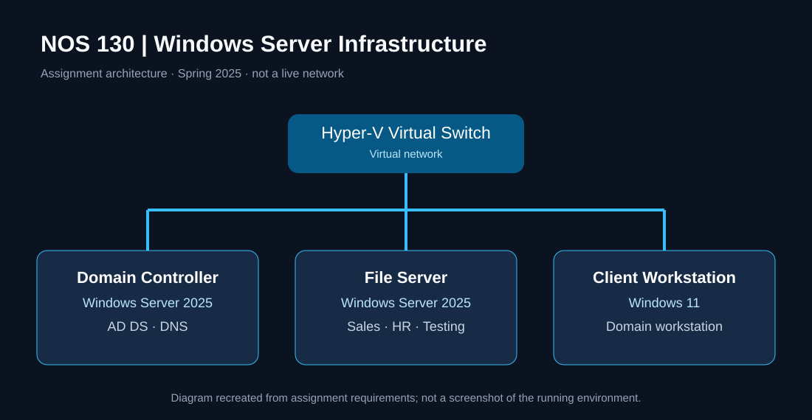
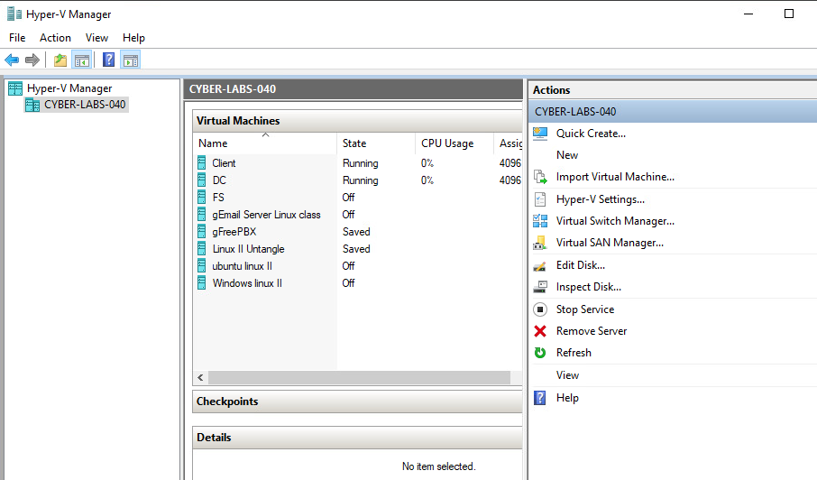
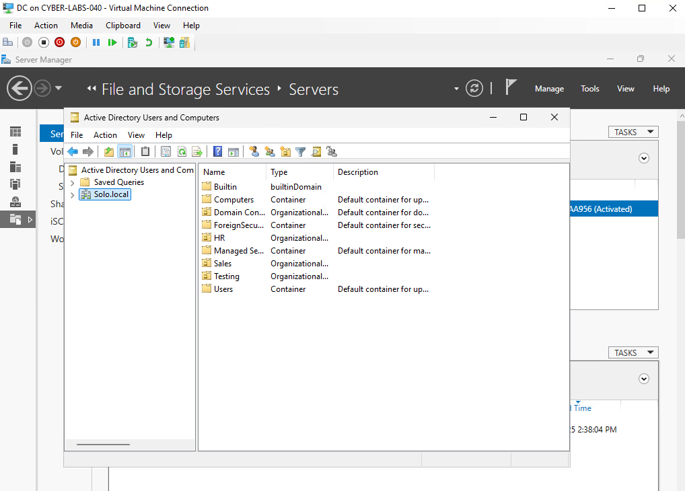
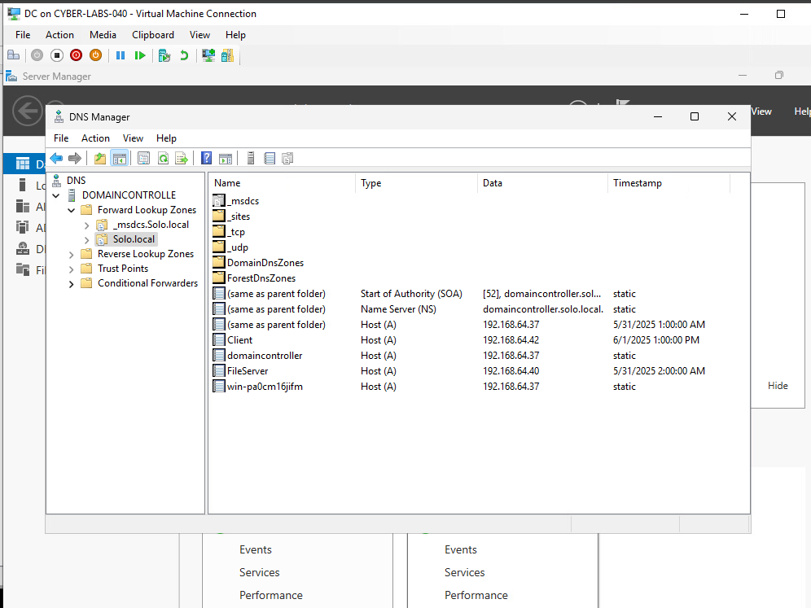
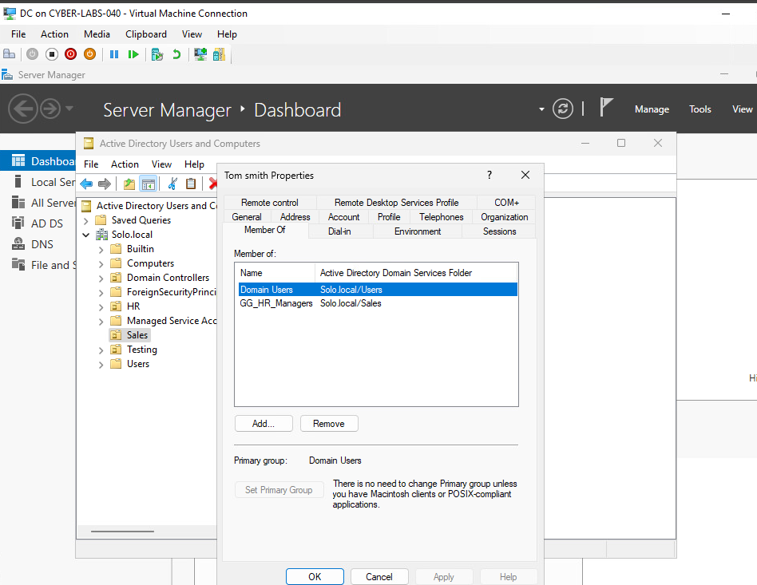
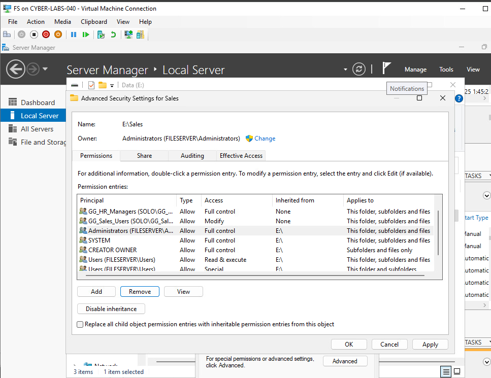
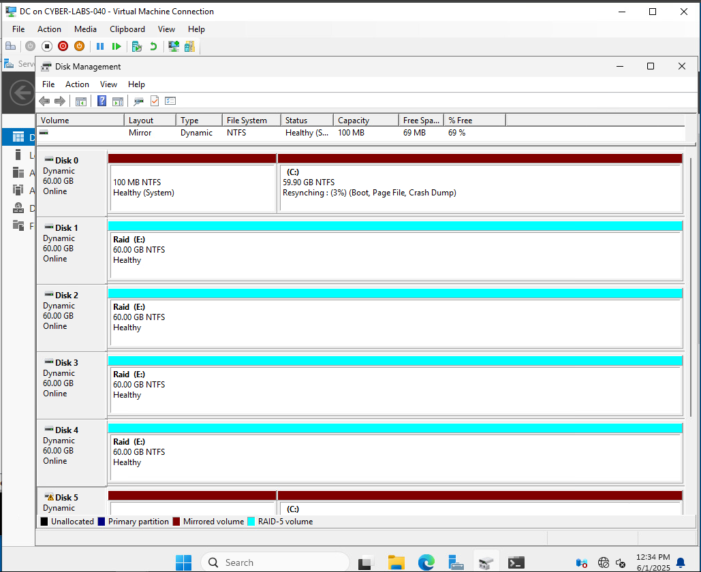

# Windows Server 2025 — Active Directory & File Services Lab

**NOS 130 · Network Operating and Systems Security · Spring 2025**  
**Project type:** Retrospective infrastructure lab | **Domain:** `Solo.local` | **Platform:** Microsoft Hyper-V



> **Portfolio evidence notice:** This project is reconstructed from screenshots retained in my original school submission. The original virtual machines are no longer available. Screenshots document configuration screens at the time of the assignment; they are not evidence of current operation, end-to-end test results, or completed requirements without corresponding captures.

## At a glance

| Business scenario | Environment | Core focus | Evidence |
|---|---|---|---|
| 15 staff in Sales, HR, Testing | 2 Windows Server 2025 VMs + 1 Windows 11 client | Identity, DNS, file access, storage | 23 project screenshots |

**My work:** Configured and documented a Windows domain lab in Hyper-V, including server/client consoles, Active Directory objects, Sales group membership, shared-folder permission settings, and disk management views. The screenshots provide the strongest evidence for Sales; HR/Testing implementation details and functional validation are not established by the surviving worksheet.

**Quick review:** [Architecture](#architecture-and-systems) · [Screenshots](#selected-implementation-evidence) · [Access model](#identity-and-access-control) · [Evidence status](#what-the-evidence-proves) · [Full gallery](documentation/EVIDENCE-GALLERY.md)

## Problem and requirements

The fictional company needed central authentication and name resolution, departmental shared storage, permissions assigned through groups, and fault-tolerant disks. The assignment specified **four users and one manager per department**. Regular users needed to create/change department files without deleting documents; managers needed create/change/delete access within their own department.

## Architecture and systems

The diagram above is a **reconstructed design** based on the assignment, not a live topology export.

| Component | Intended responsibility | Preserved screenshot |
|---|---|---|
| Domain controller | AD DS and DNS | [Server Manager](screenshots/operating-systems/domain-controller-server-manager.png) |
| File server | Departmental shares and storage | [Server Manager](screenshots/operating-systems/file-server-server-manager.png) |
| Windows 11 client | Domain workstation | [Computer properties](screenshots/operating-systems/windows-client-computer-properties.png) |
| Hyper-V virtual switch | VM network connectivity | [Switch settings](screenshots/hyper-v/virtual-switch-settings.png) |

## Selected implementation evidence

### 1. Hyper-V virtualization

Hyper-V Manager inventory and virtual-switch configuration were captured in the worksheet.



### 2. Active Directory and DNS

The retained captures include domain organizational units, DNS console, and account/group management views.





### 3. Sales security groups and file permissions

The worksheet includes Sales account/group membership and file-server NTFS/share permissions screens. The documented naming convention separates **global groups for identities** from **domain-local groups for resource access**.





**Security nuance:** NTFS **Write** permissions may allow deletion depending on advanced rights and inheritance. The screenshots alone do not prove the no-delete requirement was satisfied. See [Access-control design](documentation/ACCESS-CONTROL-DESIGN.md).

### 4. Storage and fault tolerance

Disk Management views were captured for the domain controller and file server. The assignment requested mirrored OS storage and RAID-5 or storage-pool data storage; recovery and redundancy health were not independently tested.



## Identity and access control

**Intended pattern:** `User account → Global security group → Domain-local resource group → Folder permissions` (AGDLP).

| Department | Intended identity groups | Intended permission groups | Evidence status |
|---|---|---|---|
| Sales | `GG_Sales_Users`, `GG_Sales_Managers` | `DLG_Sales_Write`, `DLG_Sales_Modify` | Membership and permissions screens present |
| HR | Department users and managers | Department-specific access groups | Detailed captures absent |
| Testing | Department users and managers | Department-specific access groups | Detailed captures absent |

The names for HR/Testing above describe the assignment pattern, **not verified implemented group objects**.

## What the evidence proves

| Category | Retained evidence | What remains unverified |
|---|---|---|
| Hyper-V | VM inventory, switch settings | VM-to-VM network tests |
| Server/client OS | Server Manager, client properties | Current installation state |
| AD DS / DNS | ADUC and DNS console views | Successful logon, DNS queries |
| Sales identity | Accounts and group membership | End-to-end authorization |
| Sales file access | NTFS and share permission dialogs | Create/edit/delete behavior |
| HR / Testing | Some OU-level context | Detailed accounts and permissions |
| Storage | Disk Management screenshots | Drive failure/recovery test |

See the [complete evidence matrix](documentation/EVIDENCE-MATRIX.md) for detailed gaps.

## Technical takeaways

- Built practical familiarity with Hyper-V infrastructure and Windows Server management interfaces.
- Practiced structuring directory objects and groups by department and job responsibility.
- Applied the principle of assigning shared-folder access through security groups rather than individual users.
- Learned to distinguish **configuration evidence** from **functional verification**, especially for access control and fault tolerance.

## Repository guide

```text
.
├── README.md                         # Hiring-manager overview
├── architecture/
│   └── network-topology.svg          # Reconstructed topology
├── screenshots/
│   ├── hyper-v/                      # VM and switch captures
│   ├── operating-systems/           # Server and client captures
│   ├── active-directory/            # ADUC, DNS, Sales groups
│   ├── file-server/                 # Sales NTFS/share permissions
│   └── storage/                     # Disk Management
└── documentation/
    ├── ACCESS-CONTROL-DESIGN.md
    ├── EVIDENCE-GALLERY.md
    ├── EVIDENCE-MATRIX.md
    ├── LIMITATIONS-AND-VALIDATION.md
    └── PUBLISHING-CHECKLIST.md
```

**Explore:** [All screenshots](documentation/EVIDENCE-GALLERY.md) · [Access design](documentation/ACCESS-CONTROL-DESIGN.md) · [Evidence matrix](documentation/EVIDENCE-MATRIX.md) · [Validation plan](documentation/LIMITATIONS-AND-VALIDATION.md)

---

*Lab implementation evidence: Getro Pila · NOS 130 · Spring 2025. Original instructor-authored materials are not redistributed.*
